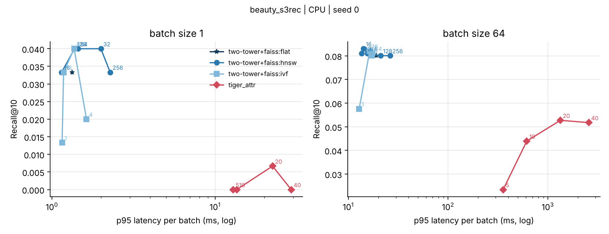

# VisID: Image-Grounded Semantic IDs for Cold-Start Generative Retrieval

**Question.** Generative retrieval models (TIGER) recommend by generating an item's *semantic
ID*, a short code sequence learned from item content, and published work builds those IDs from
text. Do semantic IDs built from **product images**, or images **fused** with text, improve
recommendations for **cold-start items**? And what does generative retrieval **cost at
inference time** compared with standard embedding retrieval through a FAISS ANN index?

Any answer is acceptable as long as it is explained; `make analyze` produces the diagnostics
that explain it.

## Answer (Amazon Beauty 5-core, 3 seeds, A100)

1. **Image-grounded IDs help warm recommendation; they do not fix cold start.** Fused
   image+text semantic IDs beat text-only IDs on warm items in every seed: **Recall@10
   0.0564 vs 0.0516 (+9.4%)**, Recall@5 +8.4%. Image-only IDs land in between (+5.9% Recall@10).
   On cold-start items no ID variant is distinguishable from another, and all are beaten by
   content two-tower retrieval (cold Recall@10 0.0172 vs at most 0.0071).
2. **Why:** image similarity predicts co-purchase better than text. 7.5% of an item's 10
   nearest image neighbours are bought adjacent to it vs 6.7% for text (fused: 8.1%), and
   image/fused IDs put consecutive purchases under the same 2-code prefix 94× more often than
   chance vs 63× for text. Images separate items less well (7.3% vs 3.8% of items need the
   collision token), and fusion keeps the co-purchase signal while text keeps items apart.
   The generator still cannot reach cold items: their final codes were never targets.
3. **Cost:** at batch 64, generative retrieval (fused IDs, beam 20) gets 0.67× the Recall@10
   of two-tower + FAISS HNSW at **4.6× the p95 latency** (33.8 ms vs 7.3 ms), and its top-10
   lists cover 41–55% of the catalog vs 80–85% for the baselines.

## Results

Mean ± std over seeds 0, 1, 2 (each seed retrains the RQ-VAE and the model; the split is
fixed). Full-catalog ranking, leave-one-out. Generated by `make results`; raw file:
`results/beauty2014/table.md` (copy the full `results/beauty2014/` folder from Drive into the
repo before publishing so the latency plot and per-run logs are included).

| Model | Warm R@5 | Warm R@10 | Warm NDCG@10 | Cold R@5 | Cold R@10 | Coverage@10 |
|---|---|---|---|---|---|---|
| SASRec, BCE (published setup) | 0.0319 ± 0.0005 | 0.0576 ± 0.0019 | 0.0247 ± 0.0006 | 0 | 0 | 0.909 |
| SASRec, full softmax | 0.0522 ± 0.0003 | 0.0786 ± 0.0009 | 0.0397 ± 0.0004 | 0 | 0 | 0.849 |
| Two-tower (text + ID) + FAISS HNSW | **0.0543 ± 0.0007** | **0.0858 ± 0.0013** | **0.0415 ± 0.0007** | **0.0089 ± 0.0004** | **0.0172 ± 0.0012** | 0.804 |
| TIGER, text IDs | 0.0327 ± 0.0007 | 0.0516 ± 0.0018 | 0.0272 ± 0.0011 | 0.0026 ± 0.0014 † | 0.0071 ± 0.0025 † | 0.549 |
| TIGER, image IDs | 0.0347 ± 0.0009 | 0.0546 ± 0.0015 | 0.0288 ± 0.0010 | 0.0006 ± 0.0004 † | 0.0054 ± 0.0040 † | 0.438 |
| TIGER, fused IDs | 0.0355 ± 0.0001 | 0.0564 ± 0.0007 | 0.0295 ± 0.0001 | 0.0023 ± 0.0015 † | 0.0054 ± 0.0028 † | 0.414 |

21,195 warm and 1,166 cold test cases. † TIGER's ε = 0.1 cold retrieval (10% of the top-K
reserved for unseen items); with ε = 0 every TIGER variant has cold recall 0. Warm numbers are
essentially identical with ε = 0 and 0.1.

**Systems benchmark** (seed 0, A100 for the models, FAISS on 1 CPU thread; `make bench`):

| | batch 1: Recall@10 / p95 | batch 64: Recall@10 / p95 |
|---|---|---|
| Two-tower + HNSW (efSearch 64) | 0.074 / 2.3 ms | 0.0835 / 7.3 ms |
| TIGER fused, beam 20 | 0.056 / 27.5 ms | 0.0562 / 33.8 ms |
| TIGER fused, beam 40 | 0.054 / 27.6 ms | 0.0566 / 50.5 ms |

Batch-1 recall uses 300 users and is noisy. Latency is flat up to beam 20, so the GPU is
underused at this model size. Without the trie, 0.01–0.03% of top-10 IDs were invalid and recall
was unchanged: at this catalog density the constraint almost never binds.

**Diagnostics** (seed 0; `make analyze`):

| IDs | Collisions (need 4th token) | Co-purchase prefix lift, depth 2 | Content kNN co-purchase precision@10 |
|---|---|---|---|
| text | 3.8% | 63× | 0.067 |
| image | 7.3% | 94× | 0.075 |
| fused | 6.7% | 94× | 0.081 |

Codebooks were fully used at every level in every run (no collapse). 99.9% of items had a
working image, so the study stayed on the 2014 dataset.

**Reproduction gap, reported honestly.** TIGER with text IDs reached Recall@5 = 0.0310 on all
test cases, 68% of the published 0.0454; BCE SASRec reached 0.0302, 78% of the published 0.0387.
The generator is not undertrained: validation recall plateaued around epochs 20–35 while
training loss kept falling. Likely causes, in order: absolute position embeddings over a
left-packed history (TIGER uses T5's relative positions; `tiger.history_align=right` is
implemented to test this), optimizer and schedule differences, and 4 heads of 32 instead of
6 of 64. The comparisons between ID types use the same generator and are unaffected.

## Pipeline validation before GPU access (CPU sandbox)

The raw Amazon files, Hugging Face weights and image CDN were not reachable from the machine
this was built on, so the pipeline was validated on S3Rec's copy of the **same Beauty 5-core
sequences** (matches the published statistics exactly) with the only offline item content:
**brand/category attribute ids** (637 attributes, 3.7 per item). Single seed, 2 CPU cores.
These are *not* the study's numbers; they check the split, baselines and generator end to end.

| Model (1 seed, CPU) | Warm R@5 | Warm R@10 | Warm NDCG@10 | Cold R@5 | Cold R@10 | Cold NDCG@10 | Coverage@10 |
|---|---|---|---|---|---|---|---|
| SASRec (full softmax) | 0.0498 | 0.0761 | 0.0378 | 0.0000 | 0.0000 | 0.0000 | 0.846 |
| Two-tower (attr + ID) + FAISS HNSW | 0.0499 | 0.0790 | 0.0383 | 0.0017 | 0.0034 | 0.0012 | 0.740 |
| TIGER, attr IDs, ε = 0 † | 0.0319 | 0.0539 | 0.0274 | 0.0000 | 0.0000 | 0.0000 | 0.218 |
| TIGER, attr IDs, ε = 0.1 † | 0.0293 | 0.0498 | 0.0255 | **0.0218** | **0.0293** | **0.0144** | — |

Warm: 21,167 test cases; cold: 1,193. Full tables: `results/beauty_s3rec/table.md`.
† CPU-budget generator (2 + 2 layers, 12 epochs ≈ 5.8K steps, vs ~200K steps in TIGER); its
validation Recall@5 was still rising at the last epoch (0.028 → 0.037 → 0.050 → 0.056 at epochs
3, 6, 9, 12), so its warm numbers are a lower bound, not a comparison with the baselines.

What it shows:
- **Semantic IDs are what reach cold items.** SASRec never retrieves a cold item (its cold
  embedding rows get no training signal by construction). The content two-tower barely does
  (cold Recall@10 0.003): its ID embeddings dominate warm scores. The generator with ε = 0.1
  reaches cold Recall@10 = 0.029, roughly 9× the two-tower, even though its IDs come from weak
  attribute content and it is badly undertrained. The cost was a small warm drop (R@5 0.0319 →
  0.0293). With ε = 0 it retrieves no cold items at all: their final codes were never targets.
- **Why it can work.** Consecutive purchases share the level-0 code 8.5% of the time against a
  0.85% chance rate (lift 9.9; lift 18 at depth 2), and a cold target shares the level-0 code
  with the user's last item 8.0% of the time, about the same as warm pairs
  (`results/beauty_s3rec/analysis/seed0.md`). That shared prefix is the path to an unseen item.
- **The full-softmax SASRec is a stronger baseline than the published one.** It reaches test
  Recall@5 = 0.0472 against the 0.0387 TIGER reports for SASRec (one sampled negative), so the
  main table reports both versions; the comparison that matters is against the stronger one.
- **Attribute content cannot separate items.** 12,101 items have only 3,120 distinct attribute
  bags, and the RQ-VAE produced 3,180 distinct 3-code prefixes: 87% of items share a prefix
  (up to 160 per prefix), so the 4th token, which the generator cannot learn for unseen items,
  carries most of the identity. This is the failure mode to measure for image IDs.
- **Generative retrieval concentrates on fewer items.** Catalog coverage@10 is 0.22 for the
  generator vs 0.85 for SASRec, the diversity issue PinRec treats as a core objective.
- **Trie constraints were never binding here.** Without the trie, 0.0% of the top-10 were invalid
  IDs at beam 20 and recall was identical on the same 2,000 users. Expect this to change with
  sparser IDs (fewer collisions, larger ID space), so re-check it for text and image IDs.
- **Codebook collapse was caught and recovered.** Level-0 utilization fell to 17% at epoch 50;
  dead-code re-seeding restored it to 100% (`results/beauty_s3rec/ids_attr/seed0/rqvae_log.jsonl`).

### Latency on CPU (sandbox)



At batch 64 (1,024 random test users, 2 CPU cores, FAISS on 1 thread), the generator at beam 20
reached Recall@10 = 0.053 with p95 = 1,335 ms per batch, while two-tower + HNSW (efSearch 64)
reached 0.081 at 15.6 ms: about 86× the p95 latency. Beam 40 bought no recall over beam 20. At
batch 1 the gap is about 16× (22.4 ms vs 1.44 ms p95); recall at batch 1 was measured on only
150 users and is noise. Latency here is CPU-only and the generator is the CPU-budget model, so
the GPU benchmark in the main study is the number to report; the shape (beam search costs
4 sequential decoder passes × beam width, ANN is one encoder pass + a sub-millisecond lookup)
is what to expect.

## Quickstart

```bash
pip install -r requirements.txt        # faiss-gpu on CUDA machines if you prefer
make test                              # 41 spec tests, ~10 s
make smoke                             # the whole pipeline on a synthetic catalog, ~8 min on CPU

# Sandbox on real interactions (downloads 2 small files from GitHub)
python -m visid.cli prepare --config configs/beauty_s3rec_attr.yaml
python -m visid.cli embed   --config configs/beauty_s3rec_attr.yaml --variant attr
python -m visid.cli build-ids --config configs/beauty_s3rec_attr.yaml --variant attr --seed 0
bash scripts/sandbox_real.sh

# Main study (GPU)
bash scripts/run_all.sh configs/beauty2014.yaml
```
Every stage is `python -m visid.cli <command> --config <cfg> [--variant v] [--seed s] [--set key=value ...]`.
One command per table: `make results` (main table, 3 seeds), `make bench` (latency plot),
`make analyze` (why-diagnostics).

## Running on Colab

Open `notebooks/visid_colab.ipynb` in Colab with an A100 runtime. Data and results live on Google
Drive, and `scripts/run_resumable.sh` skips every stage whose output already exists, so after a
disconnect you just run all cells again. The notebook times one generator epoch first so you
can budget compute units before starting the study.

## Running on a laptop (Apple Silicon)

Everything runs on an M-series Mac: PyTorch uses the Mac GPU (MPS) automatically, FAISS runs on
the CPU. What doesn't fit is the full study's 9 full-size generator runs (3 ID variants × 3
seeds), so `configs/laptop.yaml` runs one seed with a smaller generator and writes to
`results_laptop/`:

```bash
python -m venv .venv && source .venv/bin/activate
pip install -r requirements.txt
make test                                   # ~10 s
make smoke                                  # whole pipeline on synthetic data; confirms MPS works
make all C=configs/laptop.yaml SEEDS=0      # the study at laptop scale
```
Budget from the first epoch: each `train_log.jsonl` records seconds per epoch. Plug the laptop
in (a fanless Air throttles under sustained load) and keep a few GB of disk free for the
raw files, ~12K product images, model weights and embeddings. For the 3-seed, full-size table, run the same commands with
`configs/beauty2014.yaml` on a GPU (a Colab or cloud GPU is enough). Latency measured on a
laptop is laptop latency; label it that way in the write-up.

## Data

1. Put `reviews_Beauty_5.json.gz` and `meta_Beauty.json.gz` (McAuley et al. 2014,
   <https://cseweb.ucsd.edu/~jmcauley/datasets/amazon/links.html>) in `data/raw/`, or let
   `prepare` try the mirrors.
2. `make data` builds the sequences and split, **exits with an error unless the statistics equal
   22,363 / 12,101 / 198,502**, then probes 500 image URLs.
3. If more than 15% of image URLs are dead, switch to Amazon Reviews 2023
   (`configs/beauty2023.yaml`, files from <https://amazon-reviews-2023.github.io/>) and record the
   dataset change and its statistics in the results.
4. `make images embed` downloads images and computes Sentence-T5 text, SigLIP image and fused
   embeddings; image coverage is written next to the embeddings.

## Protocol

- **Split.** Leave-one-out (TIGER): last item = test, second-to-last = validation.
- **Cold start.** 5% of test-target items (seed 42) are removed from training entirely: from
  every history, every target, *and* from the softmax / negative pool of every baseline. Warm
  and cold test cases are reported separately; all models rank the full catalog.
- **Metrics.** Recall@{5,10}, NDCG@{5,10}; mean ± std over seeds 0, 1, 2 (each seed retrains
  the RQ-VAE and the model; the split is fixed). Coverage and cold-slot share are also logged.
- **Semantic IDs.** Every content variant is PCA-projected to 512-d and L2-normalized, then an
  RQ-VAE (3 × 256 codes, k-means init, dead-code re-seeding) produces 3 codes; a 4th token
  disambiguates collisions. Utilization and perplexity per level are logged every 50 epochs.
- **Generator.** Encoder–decoder transformer (4 + 4 layers, d = 128). Each step predicts within
  its own level's codebook; beam search is masked by a prefix trie, so only catalog IDs come out.
  TIGER's ε (share of top-K reserved for unseen items) is reported at 0 and 0.1.
- **Benchmark.** End-to-end latency from user histories to top-10 ids, batch 1 and 64, p50/p95
  over batches after warm-up: TIGER at beams 5–40 vs the two-tower user encoder + FAISS
  Flat / HNSW (efSearch 16–256) / IVF (nprobe 1–64).

Known deviations from TIGER: AdamW + cosine schedule (TIGER: Adagrad, inverse-sqrt), 4 heads of
32 (TIGER: 6 of 64), and fewer steps. Record the reproduction gap honestly rather than tuning to it.

## Repository layout

```
visid/data/     loaders (2014, 2023, S3Rec, synthetic), k-core, splits, image check/download
visid/ids/      text / image / fused / attribute encoders, RQ-VAE, collision token, prefix trie
visid/models/   SASRec + two-tower, TIGER, constrained beam search, training loops
visid/eval/     metrics, warm/cold breakdown, coverage, why-diagnostics
visid/bench/    latency sweeps and the recall-vs-latency plot
visid/cli.py    the only module that knows paths; one subcommand per stage
configs/        base.yaml + per-dataset configs; every run logs its resolved config
tests/          spec tests, written before the code they test
docs/           write-up draft, AI error log, interview notes
CLAUDE.md       context file for Claude Code (boundaries, invariants, commands)
```

## Engineering notes

- Tests were written from the spec first: split correctness and cold-item isolation, metrics
  against hand-computed values, trie decoding (only valid IDs; exhaustive beam = brute force),
  RQ-VAE round trip, raw-format loaders, and an end-to-end "TIGER memorizes a tiny dataset" test.
- Fixed seeds; every run writes `config.yaml` (with git hash), `train_log.jsonl`, `metrics.json`.
- `docs/ai_error_log.md` records where AI-generated code was wrong and what caught it.

## References

- Rajput et al., *Recommender Systems with Generative Retrieval* (TIGER), NeurIPS 2023.
- Pinterest, *PinRec: Unified Generative Retrieval for Pinterest Recommender Systems*, arXiv 2504.10507 (v2 titled *Outcome-Conditioned, Multi-Token Generative Retrieval for Industry-Scale Recommendation Systems*).
- Kang & McAuley, *Self-Attentive Sequential Recommendation* (SASRec), ICDM 2018.
- Klenitskiy & Vasilev, *Turning Dross Into Gold Loss: is BERT4Rec really better than SASRec?*, RecSys 2023.
- Zhou et al., *S3-Rec*, CIKM 2020 (source of the preprocessed Beauty sequences used in the sandbox).
