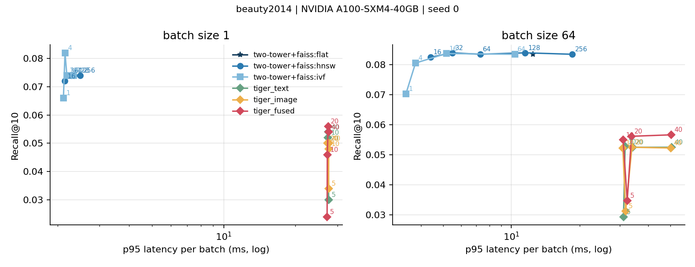

# VisID: do image-grounded semantic IDs help cold-start generative retrieval?

*Every number below comes from `results/beauty2014/` (3 seeds, Colab A100).*

## 1. Question

Generative retrieval (TIGER; Rajput et al., 2023) represents each item by a semantic ID, a short
code sequence learned from item content, and trains a sequence-to-sequence model to generate
the next item's ID. Published work builds the IDs from text. We ask:

1. Do IDs built from product **images**, or from images **fused** with text, improve
   recommendation of **cold-start items** (items never seen in training)?
2. What does generative retrieval **cost at inference** compared with two-tower retrieval
   served from a FAISS ANN index?

## 2. Setup

**Data.** Amazon Beauty 5-core (McAuley et al., 2015): 22,363 users, 12,101 items, 198,502
interactions; the pipeline refuses to continue unless these statistics are reproduced.
Images: 12,094 of 12,101 items (99.9%) had a downloadable main image, well under the 15%
dead-image threshold, so no dataset change was needed. The 7 items without one get the mean
image embedding.

**Split.** Leave-one-out per user: last item = test target, second-to-last = validation
target. Cold start follows TIGER: 5% of the items that appear as test targets (399 of 7,978,
split seed 42) are removed from all training data, and every non-target interaction with them
is dropped, leaving 1,166 cold and 21,195 warm test cases (exact drop counts in
`data/processed/beauty2014/stats.json`). Cold items are also excluded from the
softmax denominator and negative pool of every baseline, so no model receives any signal about
them; all models rank the full catalog.

**Metrics.** Recall@{5,10} and NDCG@{5,10}, reported separately for warm and cold test cases,
mean ± std over 3 seeds (seed varies the RQ-VAE and the model; the split is fixed).

**Item content.** Three variants, each PCA-projected to 512 dimensions and L2-normalized so the
RQ-VAE sees inputs of identical size and scale:
- *text*: Sentence-T5-base over "Title. Brand. Categories. Price."
- *image*: SigLIP-base image embedding of the main product image (mean embedding for items
  without an image; coverage reported)
- *fused*: concatenation of L2-normalized text and image embeddings, equally weighted

**Semantic IDs.** RQ-VAE, encoder 512→512→256→128→32, 3 levels × 256 codes, β = 0.25,
k-means initialization and dead-code re-seeding, 1000 epochs. A 4th token indexes the item
within its group of items sharing all 3 codes. Utilization and perplexity per level are logged.

**Generator.** Encoder–decoder transformer (4 + 4 layers, d = 128, FFN 1024, dropout 0.1).
Input: a hashed user token plus the 4-token IDs of the last 20 items. Output: the next item's
4 tokens, each predicted over its own level's codebook. Inference uses beam search (beam 20)
constrained by a prefix trie over all catalog IDs. For cold items we also report TIGER's
ε = 0.1 retrieval, which reserves 10% of the top-K for unseen items whose first three codes match
a generated beam.

**Baselines.** SASRec (ID embeddings, full-softmax loss). Two-tower: the same causal
transformer user tower with an item tower = MLP(text embedding) + ID embedding (ID dropout 0.5
during training; zero ID vector for cold items), served from FAISS HNSW (M = 32, efSearch = 64).

## 3. Results

### 3.1 Reproduction
| Recall@5, all test cases | ours (mean ± std, 3 seeds) | published |
|---|---|---|
| SASRec, BCE (original setup) | 0.0302 ± 0.0005 | 0.0387 |
| SASRec, full softmax | 0.0494 ± 0.0003 | — |
| TIGER, text IDs | 0.0310 ± 0.0006 | 0.0454 |

Our TIGER reaches 68% of the published Recall@5 and BCE SASRec 78%. The full-softmax SASRec
(Klenitskiy & Vasilev, 2023) exceeds both published numbers, so it is the baseline that matters.
The generator is not undertrained: in every run validation Recall@5 plateaued around epochs
20–35 (≈0.05 on 3,000 validation users) while training loss kept falling from ≈2.3 to ≈1.3–1.5, and
early stopping ended training at epochs 50–80. Deviations from TIGER that can explain the gap:
(i) learned absolute position embeddings over a left-packed history, so the most recent item's
position varies with history length (TIGER's T5 uses relative positions; a right-aligned
variant is implemented as `tiger.history_align=right`); (ii) AdamW with a cosine schedule
instead of Adagrad with inverse-square-root decay; (iii) 4 heads of width 32 instead of 6 of
64; (iv) our training data excludes the cold items' interactions. All ID variants share the
same generator, so the comparisons between them are unaffected.

### 3.2 Image and fused IDs, warm vs cold
| Model | Warm R@5 | Warm R@10 | Cold R@10 |
|---|---|---|---|
| Two-tower (text + ID) + FAISS HNSW | 0.0543 ± 0.0007 | 0.0858 ± 0.0013 | 0.0172 ± 0.0012 |
| SASRec, full softmax | 0.0522 ± 0.0003 | 0.0786 ± 0.0009 | 0 |
| TIGER, text IDs | 0.0327 ± 0.0007 | 0.0516 ± 0.0018 | 0.0071 ± 0.0025 |
| TIGER, image IDs | 0.0347 ± 0.0009 | 0.0546 ± 0.0015 | 0.0054 ± 0.0040 |
| TIGER, fused IDs | 0.0355 ± 0.0001 | 0.0564 ± 0.0007 | 0.0054 ± 0.0028 |

Cold columns for TIGER use ε = 0.1; with ε = 0 every TIGER variant has cold recall 0.

**Warm.** Fused IDs beat text IDs in every seed: Recall@10 +10.4%, +4.3% and +13.8% (mean
+9.4%), Recall@5 +8.4% on average. Image-only IDs also beat text in every seed, by less
(+5.9% Recall@10). Fused IDs are also the most stable across seeds (std 0.0007 vs 0.0018).

**Cold.** 1,166 cold cases at Recall@10 ≈ 0.005–0.007 means 6–8 hits per run; the seed-to-seed
spread is as large as the differences, so no ID variant is distinguishable from another. Every
generative variant is beaten by the content two-tower (0.0172, 2.4× the best TIGER variant).

### 3.3 Why the image results came out the way they did
| IDs | collision rate | prefix lift of consecutive purchases, depth 1 / 2 | cold agreement, depth 1 | content kNN co-purchase precision@10 |
|---|---|---|---|---|
| text | 3.8% | 19× / 63× | 8.1% | 0.067 |
| image | 7.3% | 22× / 94× | 7.5% | 0.075 |
| fused | 6.7% | 23× / 94× | 8.3% | 0.081 |

- **Image similarity predicts co-purchase better than text.** Of an item's 10 nearest
  neighbours in embedding space, 7.5% (image) vs 6.7% (text) are bought adjacent to it in some
  training sequence; fusing gives 8.1%. Before the run we expected the opposite: Beauty
  packaging looks generic (white bottles, tubes, jars). In practice, visual style tracks the
  brand and product line, which drive repeat and complementary purchases.
- **That signal survives quantization.** Consecutive purchases share a 2-code prefix 94× more
  often than chance under image or fused IDs vs 63× under text IDs, so the generator's first
  two tokens are easier to predict. This is consistent with the warm gains.
- **Images separate items less well.** Image IDs need the collision token for 7.3% of items
  (groups up to 14) vs 3.8% for text (up to 4). Fusion lands in between on separation (6.7%)
  while keeping the image prefix structure, which matches fused IDs being best overall.
- **Why cold start does not improve.** A cold target shares the level-0 code with the user's
  last item almost as often as warm consecutive purchases do (7.5–8.3% vs 8.6–11.0%), so the
  prefix path exists. But the
  generator never produced a cold item's later codes as a training target, so plain beam search
  never completes them (cold recall 0 at ε = 0). ε-mixing reaches a few, but a content tower that
  scores every item directly does better.

### 3.4 Cost of generative retrieval

At batch 64, TIGER (fused IDs, beam 20) reached Recall@10 0.0562 at p95 33.8 ms per batch;
two-tower + HNSW (efSearch 64) reached 0.0835 at 7.3 ms: **0.67× the recall at 4.6× the p95
latency**. At batch 1 the latency ratio is about 12× (27.5 ms vs 2.3 ms). TIGER latency is flat
from beam 5 to 20 and rises only at 40 (50.5 ms), so the GPU is underused at this model size.
FAISS ran on one CPU thread and the models on an A100, so absolute numbers are setup-specific;
the ratios are the result. Without the trie, only 0.01–0.03% of top-10 IDs were invalid and
recall was identical, so at this density the trie is a guarantee rather than a recall gain.
Generative top-10 lists cover 41–55% of the catalog vs 80–85% for the baselines.

## 4. Pipeline validation on real interactions (CPU)

Before the GPU run, the full pipeline ran on the exact Beauty 5-core sequences with the only
item content available offline: brand/category attribute ids (637 attributes, 3.7 per item).
These "attr" IDs are **not** the text IDs of the study; the run validates the split, the
baselines and the generator end to end, and shows one mechanism in isolation. Results and
discussion: see README, "Sandbox results".

## 5. Limitations
- One dataset, one image encoder, a single fusion rule (equal-weight concatenation).
- Images missing or dead for some items are replaced by the mean image embedding, which makes
  those items' image IDs uninformative; coverage is reported with every image result.
- Latency is measured on one GPU and FAISS on CPU threads; absolute numbers are
  hardware-specific, the ratios are the result.
